# capital-invest-platform

Plateforme numérique de Capital Invest SA (Kolwezi, RDC) : application mobile, carte prépayée
Visa ou Mastercard (physique et virtuelle), menu USSD, back-office et paie B2B.

## Organisation du dépôt

| Dossier | Contenu | Technologie |
| --- | --- | --- |
| `backend/` | Serveur : grand livre, clients, paiements, cartes, crédit, USSD | Kotlin, Spring Boot 3.5, PostgreSQL 16 |
| `mobile/` | Application Android et iOS | Flutter 3.50 (Dart) |
| `backoffice/` | Back-office des agents (KYC 2, promotions, agents, journal) | TypeScript, React |
| `docs/` | Documents d'analyse et décisions d'architecture | |

## Démarrer le serveur en local

Prérequis : JDK 21 et PostgreSQL 16.

```bash
createuser -P capital            # mot de passe : capital (développement uniquement)
createdb -O capital capital_invest
createdb -O capital capital_invest_test
cd backend
./gradlew test                   # tests sur la base capital_invest_test
./gradlew bootRun                # API sur http://localhost:8080
```

Variables utiles : `DB_URL`, `DB_USER`, `DB_PASSWORD`, `PORT`, `SIMULATORS_ENABLED` (à `false` en production). Pour les opérateurs mobile money, voir plus bas.

## Essayer l'API

Toutes les routes `/v1` demandent `Authorization: Bearer <jeton>`, sauf l'inscription, la connexion
et les simulateurs. Les montants sont en centimes.

```bash
# 1. Recevoir le code SMS (simulé), puis le lire
curl -s -X POST localhost:8080/v1/auth/otp -H 'Content-Type: application/json' -d '{"phone":"+243970000001"}'
curl -s localhost:8080/v1/simulators/sms/+243970000001

# 2. S'inscrire avec le code et un PIN (4 chiffres, ni 1234 ni 1111)
curl -s -X POST localhost:8080/v1/auth/register -H 'Content-Type: application/json' \
  -d '{"phone":"+243970000001","code":"123456","fullName":"Mwamba Ilunga","language":"sw","pin":"2580","deviceId":"tel-1"}'
# -> {"accessToken":"...", ...}

# 3. Recharger 50 USD par M-Pesa, puis simuler la confirmation de l'opérateur
curl -s -X POST localhost:8080/v1/topups -H "Authorization: Bearer $TOKEN" -H 'Idempotency-Key: 6f1c' \
  -H 'Content-Type: application/json' -d '{"operator":"MPESA","amountMinor":5000}'
curl -s -X POST localhost:8080/v1/simulators/mobile-money/callbacks -H 'Content-Type: application/json' \
  -d '{"topupId":"<id>","success":true}'

# 4. Envoyer 12,50 USD à un autre client (PIN obligatoire), puis lire son solde
curl -s -X POST localhost:8080/v1/transfers -H "Authorization: Bearer $TOKEN" -H 'Idempotency-Key: 9a2b' \
  -H 'Content-Type: application/json' -d '{"toPhone":"+243970000002","amountMinor":1250,"pin":"2580"}'
curl -s localhost:8080/v1/me/balance -H "Authorization: Bearer $TOKEN"

# 4 bis. Connaître les frais avant de confirmer
curl -s 'localhost:8080/v1/transfers/fee?amountMinor=1250' -H "Authorization: Bearer $TOKEN"

# 5. Voir ses plafonds et ce qui reste à envoyer aujourd'hui
curl -s localhost:8080/v1/me/limits -H "Authorization: Bearer $TOKEN"

# 6. PIN oublié : code SMS, puis nouveau PIN
curl -s -X POST localhost:8080/v1/auth/pin-reset/otp -H 'Content-Type: application/json' -d '{"phone":"+243970000001"}'
curl -s -X POST localhost:8080/v1/auth/pin-reset -H 'Content-Type: application/json' \
  -d '{"phone":"+243970000001","code":"123456","newPin":"7391","deviceId":"tel-neuf"}'
```

## Sécurité de la connexion

- Code SMS à 6 chiffres, valable 5 minutes, 5 essais au plus, 3 demandes au plus par 10 minutes ; stocké haché (HMAC).
- PIN haché en BCrypt ; 5 erreurs bloquent le compte 15 minutes ; le PIN est redemandé pour chaque envoi.
- Jetons de session aléatoires, stockés hachés, révocables ; expiration après 15 minutes d'inactivité et 12 heures au plus.
- PIN oublié : code SMS, nouveau PIN, toutes les anciennes sessions fermées. Les envois sont ensuite suspendus 24 heures, contre le vol de carte SIM. La demande de code répond de la même façon que le numéro ait un compte ou non.
- Changer son PIN depuis l'app (Profil, **Sécurité et PIN**) : il faut l'ancien PIN. Les autres téléphones sont déconnectés, celui-ci reste connecté, et le client reçoit un SMS. Pas de suspension des envois : l'ancien PIN prouve que c'est bien le titulaire.
- Connexions récentes : les 10 dernières, avec le nom du téléphone (« Samsung Galaxy A14 ») envoyé par l'app à la connexion. Le client peut déconnecter tous ses autres téléphones.
- Nouveau téléphone : une connexion depuis un téléphone jamais vu sur ce compte envoie un SMS au client (« Si ce n'est pas vous, appelez vite le service client »). L'app tire un identifiant de téléphone à la première ouverture et le garde.
- API : `POST /v1/me/security/pin` (`currentPin`, `newPin`), `GET /v1/me/security/sessions`, `POST /v1/me/security/sessions/sign-out-others`. `deviceName` est facultatif à l'inscription, à la connexion et au PIN oublié.
- En production : `OTP_SECRET` et `KYC_ENCRYPTION_KEY` obligatoires, `SIMULATORS_ENABLED=false`.

## Verrouillage automatique et solde masqué

Un téléphone posé sur une table ou volé alors qu'il est déverrouillé ne doit pas laisser l'argent accessible. Quand le client quitte l'app plus longtemps que le délai choisi, l'app **redemande le PIN à son retour**. Les écrans ouverts sont fermés et la session aussi. Le numéro reste rempli, et un mot explique pourquoi. Le délai se règle dans Sécurité : tout de suite, 1 minute (par défaut) ou 5 minutes.

Sur l'accueil, l'œil à côté de « Solde » **masque le solde et l'épargne**, pour sortir son téléphone en public sans montrer ce qu'on a. Les deux choix sont gardés sur le téléphone.

| Solde masqué | Délai de verrouillage | App verrouillée |
|---|---|---|
| 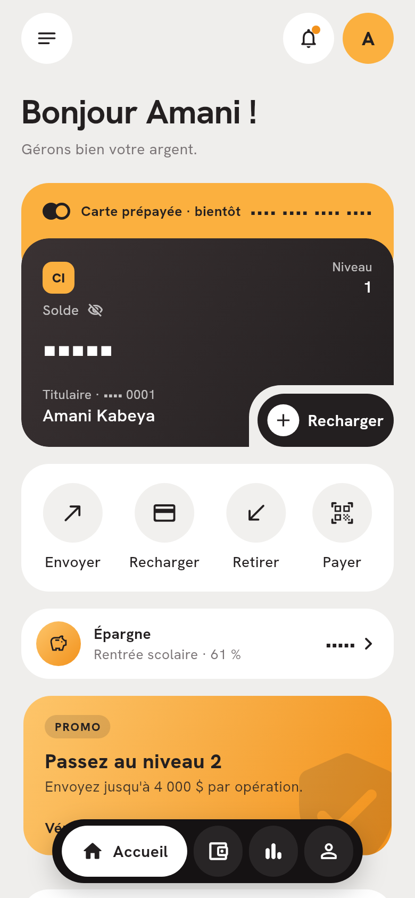 | 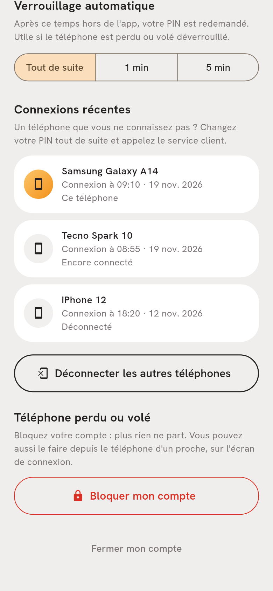 | 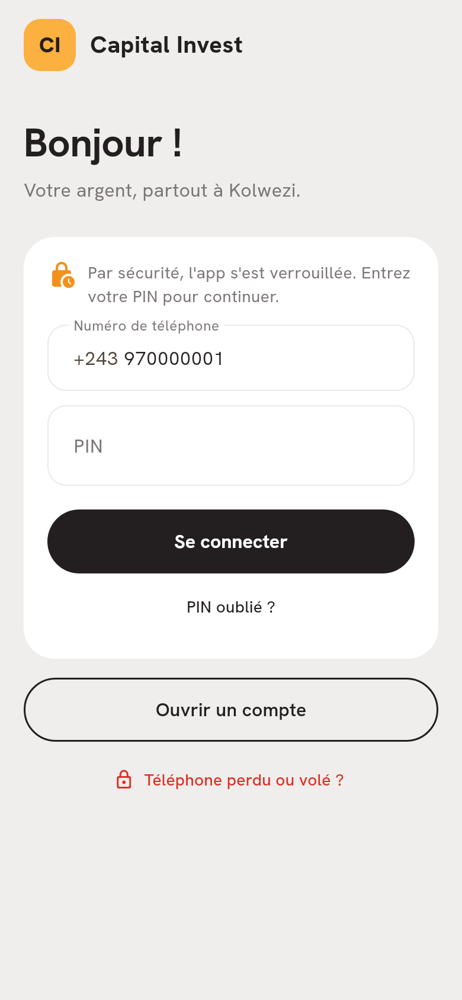 |

- Le délai compte à partir du passage en arrière-plan (`paused`). L'appareil photo du KYC et le partage d'un reçu ou d'un relevé font quitter l'app un moment : ils ne la verrouillent pas.
- Le verrouillage ferme aussi la session côté serveur (`/v1/auth/logout`) : le jeton ne peut plus servir.
- Tout se passe dans l'app : le serveur ne change pas.

## Téléphone perdu ou volé : bloquer son compte

Le client bloque lui-même son compte, sans attendre le service client :

- depuis l'app : Profil, **Sécurité et PIN**, **Bloquer mon compte**, avec le PIN ;
- depuis le téléphone d'un proche, sans se connecter : **Téléphone perdu ou volé ?** sur l'écran de connexion, avec son numéro et son PIN.

Ce qui se passe :

- Toutes les sessions tombent et la connexion est refusée avec la marche à suivre (`CUSTOMER_BLOCKED`).
- Plus rien ne part : envois, retraits, paiements, envois programmés. Le compte ne reçoit plus d'argent non plus.
- Le client reçoit un SMS de confirmation.
- Le PIN est exigé pour qu'un inconnu ne puisse pas bloquer le compte de quelqu'un d'autre. Les erreurs comptent comme à la connexion : 5 erreurs bloquent le PIN 15 minutes.
- Un compte déjà suspendu par la conformité le reste : le client ne peut pas changer une suspension en « bloqué à sa demande ».

Le déblocage se fait **en agence seulement**, après vérification de la pièce d'identité. Le voleur a souvent la carte SIM, donc un code SMS ne prouve rien. Dans le back-office, la fiche client affiche « Bloqué par le client » et la date, avec un bouton **Débloquer** qui demande le type et le numéro de la pièce vue. Le client reçoit un SMS qui l'invite à changer son PIN.

- API : `POST /v1/me/security/block` (`pin`) depuis l'app, `POST /v1/auth/block` (`phone`, `pin`) sans session. Le déblocage passe par la route existante `POST /v1/backoffice/customers/{id}/status`.
- Journal d'audit : `CUSTOMER_SELF_BLOCKED`, puis `CUSTOMER_REACTIVATED` avec la pièce notée par l'agent.

| Bloquer depuis l'app | Compte bloqué |
|---|---|
| 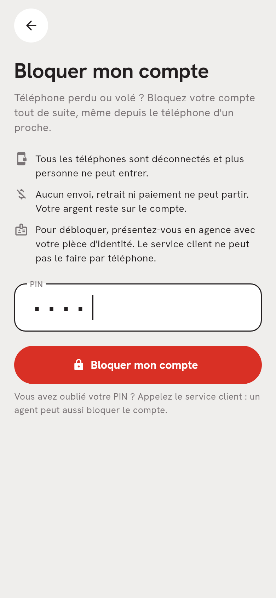 | 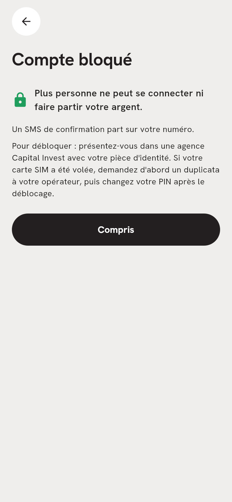 |

## Fermer son compte

Dans l'app, sous Sécurité, tout en bas, **Fermer mon compte**.

- **Ce qu'il faut d'abord :** que le compte soit vide (portefeuille et épargne) et qu'aucune opération ne soit en cours (recharge, retrait, crédit ou facture). L'écran liste ce qu'il reste à faire, avec les montants. Aucun argent ne peut rester bloqué sur un compte fermé.
- **Pour confirmer :** le client choisit un motif (ne s'en sert plus, frais, autre service, déménagement, autre), peut laisser un commentaire, puis donne son PIN.
- **Ce que fait la fermeture :**
  - le compte et ses comptes du grand livre passent en `CLOSED` ;
  - les envois programmés sont arrêtés ;
  - les demandes d'argent en attente sont annulées ;
  - toutes les sessions sont fermées ;
  - le client reçoit un SMS.
- **Ensuite :**
  - la connexion est refusée avec le code `CUSTOMER_CLOSED` ;
  - personne ne peut plus envoyer d'argent sur ce numéro ;
  - les opérations et le dossier KYC sont conservés ;
  - le numéro reste attaché au compte fermé, et rouvrir un compte se fait en agence.
- **Back-office :** la fiche client affiche « Compte fermé », avec la date, le motif et le commentaire.
- API : `GET /v1/me/closure` (ce qu'il reste à faire), `POST /v1/me/closure` (`pin`, `reason`, `comment`). Journal d'audit : `CUSTOMER_CLOSED`.


## Plafonds KYC

Valeurs **provisoires**, à valider par la conformité (fichier `application.yml`, section `capital-invest.limits`).

| Niveau | Par opération | Envoyé par jour | Solde maximal |
|---|---|---|---|
| KYC 1 | 200 $ | 600 $ | 1 000 $ |
| KYC 2 | 4 000 $ | 10 000 $ | 20 000 $ |

- La journée se compte à l'heure de Lubumbashi.
- Le solde maximal compte aussi les recharges en attente et l'épargne, et s'applique au destinataire d'un envoi sans révéler son solde.
- Les contrôles se font sous verrou du portefeuille : deux opérations simultanées ne peuvent pas dépasser un plafond ensemble.

## Plafond d'envoi choisi par le client

Dans l'app, sous Sécurité, puis **Plafond d'envoi par jour**, le client choisit un plafond plus bas que celui de son niveau, par exemple 50 $ par jour. Si quelqu'un lui vole son téléphone et son PIN, il ne peut pas tout prendre.

- **Baisser** le plafond s'applique tout de suite.
- **Remonter** le plafond, ou revenir à celui du niveau, ne prend effet que **24 heures plus tard**. Le client reçoit un SMS et peut annuler la hausse depuis l'app, sans PIN. Il a ainsi le temps de réagir si ce n'est pas lui, et de bloquer son compte.
- Le plafond compte tout ce qui sort dans la journée, comme le plafond du niveau : envois, retraits, paiements chez les marchands, factures et crédit téléphone.
- Bornes : de 10 $ jusqu'au plafond du niveau. Le PIN est demandé à chaque changement.
- Code d'erreur `LIMIT_DAILY_PERSONAL`, distinct de `LIMIT_DAILY`, pour que l'app indique où changer le plafond.
- Le back-office affiche ce plafond et la hausse en attente sur la fiche client.
- API :
  - `PUT /v1/me/limits/daily` (`dailyOutMinor`, ou `null` pour revenir au plafond du niveau, et `pin`) ;
  - `DELETE /v1/me/limits/daily/pending` pour annuler la hausse en attente ;
  - `GET /v1/me/limits` renvoie en plus `levelDailyOutMinor`, `personalDailyOutMinor` et `pendingDailyOut`.
- Journal d'audit : `DAILY_LIMIT_LOWERED`, `DAILY_LIMIT_RAISE_REQUESTED`, `DAILY_LIMIT_RAISE_CANCELLED`.

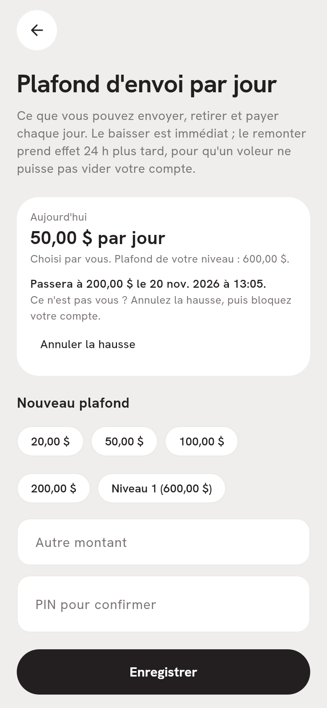

## Frais d'envoi

Valeurs **provisoires**, à fixer par la direction générale (`capital-invest.fees` dans `application.yml`) : 1 % du montant, au moins 0,10 $, au plus 5 $.

- L'expéditeur paie le montant plus les frais ; le destinataire reçoit le montant entier.
- Les frais sont crédités au compte `FEES_REVENUE_USD` dans la même transaction du grand livre.
- Les frais ne comptent pas dans le plafond journalier d'envoi.

## Passage au KYC 2

Côté client (jeton client) :

1. `POST /v1/me/kyc/documents/{ID_FRONT|ID_BACK|SELFIE}` : photo JPEG ou PNG, champ multipart `file`, 5 Mo au plus. Le type est vérifié sur le contenu du fichier.
2. `POST /v1/me/kyc/submission` : `{"idType":"VOTER_CARD|PASSPORT","idNumber":"…","birthDate":"1990-05-12"}`. Le verso est obligatoire pour la carte d'électeur. Il faut avoir 18 ans.
3. `GET /v1/me/kyc` : niveau actuel et état de la dernière demande, avec le motif en cas de refus.

Côté back-office (jeton agent, distinct des jetons clients) :

- `POST /v1/backoffice/auth/login` : e-mail et mot de passe (12 caractères au moins). 5 erreurs bloquent le compte 15 minutes ; session de 15 minutes d'inactivité, 8 heures au plus.
- `GET /v1/backoffice/kyc?status=PENDING`, `GET /v1/backoffice/kyc/{id}`, `GET /v1/backoffice/kyc/{id}/documents/{docId}`.
- `POST /v1/backoffice/kyc/{id}/approve` ou `/reject` avec `{"reason":"…"}`. Le client reçoit un SMS.
- `GET /v1/backoffice/me` : l'agent connecté. `GET /v1/backoffice/agents`, `POST /v1/backoffice/agents/{id}/disable` ou `/enable` (administrateurs). Désactiver un agent ferme ses sessions.
- `GET /v1/backoffice/audit` : journal d'audit (conformité et administrateurs).
- Les routes KYC sont réservées aux rôles `KYC_AGENT`, `COMPLIANCE` et `ADMIN`.
- `POST /v1/backoffice/agents` : création d'un agent (`KYC_AGENT`, `COMPLIANCE`, `ADMIN`, `MARKETING`), réservée aux administrateurs. Le premier administrateur est créé au démarrage à partir de `BACKOFFICE_ADMIN_EMAIL` et `BACKOFFICE_ADMIN_PASSWORD`.

Règles :

- Les photos sont chiffrées en AES-256-GCM dans la base. En production, `KYC_ENCRYPTION_KEY` est obligatoire.
- Le contrôle sanctions et PEP est fait à l'envoi de la demande. Une correspondance ne peut être validée que par un agent `COMPLIANCE`. Le contrôle est **simulé** en attendant le choix du fournisseur.
- Un agent n'ouvre que les pièces de la demande qu'il examine. Chaque consultation, validation et refus est inscrit dans `audit_log`, en ajout seul.
- Le contrôle de vivacité du selfie viendra avec le fournisseur d'identité.

## Promotions de l'accueil

Le bandeau défilant de l'app affiche les promotions en cours.

- `GET /v1/promotions` (jeton client) : 5 promotions au plus, triées par priorité. Chacune a un titre, un texte, un style (`OCHRE`, `INK`, `GREEN`, `SKY`) et, si elle a un bouton, son texte et son action dans l'app (`KYC`, `TOPUP`, `TRANSFER`, `LIMITS`).
- Une promotion n'est montrée que si elle est active, dans sa période (`startsAt`, `endsAt`) et destinée au niveau du client (`ALL`, `KYC1` ou `KYC2`). Ainsi « Passez au niveau 2 » disparaît une fois le client vérifié.
- Back-office, rôles `MARKETING` ou `ADMIN` : `GET /v1/backoffice/promotions`, `POST /v1/backoffice/promotions`, `PUT /v1/backoffice/promotions/{id}`. On retire une promotion avec `"active": false` : rien n'est effacé, et chaque changement est inscrit dans `audit_log`.
- Trois promotions de départ sont créées par la migration V7 : passage au niveau 2, recharge mobile money, envoi aux proches.

### Visuels des graphistes

- Une promotion peut porter un visuel conçu par un graphiste : JPEG, PNG ou WebP, **1200 x 520 px** conseillé, 2 Mo au plus. Envoi depuis l'écran de la promotion dans le back-office, ou `POST /v1/backoffice/promotions/{id}/image` (multipart, champ `file`). Le type est vérifié sur le contenu du fichier, pas sur son nom. Chaque envoi est inscrit dans `audit_log`.
- Avec un visuel, seul le titre reste obligatoire (il est lu par le lecteur d'écran) ; le texte et le texte du bouton deviennent facultatifs, et tout le visuel mène à l'action choisie.
- L'app reçoit `imageUrl` (`/v1/promotions/{id}/image?v=…`) et charge l'image avec le jeton du client. Seul un client qui voit la promotion peut lire son visuel. L'adresse change à chaque nouveau visuel, le téléphone peut donc le garder en cache 7 jours.
- Sans visuel, ou si le chargement échoue, l'app dessine la carte de secours aux couleurs de la promotion.

## Recharges mobile money (M-Pesa, Airtel Money, Orange Money)

Chaque opérateur passe par un prestataire, choisi opérateur par opérateur : `PAWAPAY` (agrégateur, un seul contrat pour les trois), `SIMULATOR` en développement, ou plus tard un contrat direct. Passer un opérateur en direct ne demandera qu'un nouveau connecteur (interface `MobileMoneyConnector`) et le changement de sa route.

- **Jamais de crédit sur la foi d'une notification.** Le webhook `POST /v1/webhooks/mobile-money/{prestataire}` ne fait que déclencher la relecture du statut chez le prestataire, par son API authentifiée. Les notifications pawaPay doivent en plus être signées (RFC 9421, clés publiées par pawaPay) : sinon, réponse 401. Tout ce qui arrive est gardé dans `mobile_money_event`.
- **Relances automatiques** : une recharge en attente est relue après 10 s, puis toutes les 20 s, 40 s… jusqu'à 5 minutes. Inconnue du prestataire après 30 minutes : échec (`NOT_RECEIVED`), rien n'a été débité.
- **Recharges à vérifier** (statut `REVIEW`) : montant reçu différent de celui demandé, ou aucune réponse sûre après 24 h. Le client voit « en vérification ». Un agent `COMPLIANCE` ou `ADMIN` crédite (après une nouvelle relecture : on crédite le montant réellement encaissé) ou clôt avec un motif.
- **Rapprochement** chaque nuit à 2 h (heure de Lubumbashi) : chaque recharge de la veille est comparée à son statut chez le prestataire. Les écarts (`CONFIRMED_NOT_CREDITED`, `CREDITED_NOT_CONFIRMED`, `AMOUNT_MISMATCH`, `STILL_PENDING`) sont à traiter dans l'écran « Rapprochement » du back-office. Toute décision est inscrite dans `audit_log`.
- L'argent pawaPay arrive sur le compte de règlement `SETTLEMENT_PAWAPAY_USD`.

Configuration de production :

| Variable | Valeur |
| --- | --- |
| `MOBILE_MONEY_ROUTE_MPESA`, `…_AIRTEL`, `…_ORANGE` | `PAWAPAY` (le serveur refuse de démarrer sur le simulateur quand `SIMULATORS_ENABLED=false`) |
| `PAWAPAY_API_TOKEN` | jeton API du tableau de bord pawaPay (obligatoire dès qu'une route est `PAWAPAY`) |
| `PAWAPAY_BASE_URL` | `https://api.pawapay.io` en production (bac à sable par défaut) |
| `PAWAPAY_CALLBACK_AUTHORITY` | domaine public de l'API, si un proxy change l'en-tête `Host` |

Dans le tableau de bord pawaPay, déclarer l'URL de notification des dépôts : `https://<domaine de l'API>/v1/webhooks/mobile-money/pawapay`, et activer les notifications signées.

Back-office (`COMPLIANCE`, `ADMIN`) : `GET /v1/backoffice/topups/review`, `POST /v1/backoffice/topups/{id}/resolve`, `GET|POST /v1/backoffice/reconciliation/runs`, `GET /v1/backoffice/reconciliation/items`, `POST /v1/backoffice/reconciliation/items/{id}/resolve`.

## Retraits vers mobile money

Le client envoie son solde vers son propre numéro M-Pesa, Airtel Money ou Orange Money, par le même prestataire que les recharges (pawaPay en production).

- `GET /v1/withdrawals/fee?amountMinor=4000` : frais et total avant confirmation. Frais provisoires : 1,5 %, au moins 0,25 $, au plus 7,50 $ (40 $ coûtent 0,60 $).
- `POST /v1/withdrawals` (en-tête `Idempotency-Key`, corps `operator`, `amountMinor`, `pin`) : réponse 202, statut `PENDING`. `GET /v1/withdrawals/{id}` pour suivre.
- **L'argent est bloqué dès la demande** : montant et frais quittent le portefeuille vers le compte `PAYOUTS_IN_TRANSIT_USD`. Impossible de dépenser deux fois la même somme pendant le versement. Les retraits comptent dans le plafond journalier d'envoi.
- Versement confirmé : l'argent passe sur le compte de règlement du prestataire. Refus certain de l'opérateur : montant **et frais** rendus au client, avec le motif.
- **Jamais de remboursement sur un doute.** Sans réponse sûre après 24 h, le retrait passe « à vérifier ». Un agent ne peut rembourser que si le prestataire dit que le versement a échoué ou ne le connaît pas, et ne peut le noter versé que si le prestataire le dit payé. Sinon le client risquerait d'être payé deux fois.
- Le rapprochement de la nuit couvre aussi les retraits : `MARKED_PAID_NOT_PAID` (noté versé, l'opérateur dit échoué : l'agent rembourse) et `PAID_BUT_REFUNDED` (remboursé alors que l'opérateur a payé : à régler à la main).

Côté pawaPay : la même URL de notification sert aux versements (`https://<domaine de l'API>/v1/webhooks/mobile-money/pawapay`, à déclarer aussi pour les « payouts »), et le compte de versement pawaPay doit être approvisionné avant d'ouvrir les retraits.

Back-office (`COMPLIANCE`, `ADMIN`) : les retraits à vérifier apparaissent dans `GET /v1/backoffice/topups/review` (champ `type` : `TOPUP` ou `WITHDRAWAL`), et se traitent par `POST /v1/backoffice/withdrawals/{id}/resolve` (`PAID` ou `REFUND`, avec une note).

## Historique et reçus

Le client voit **une ligne par opération** (pas une ligne par écriture comptable) : recharge, envoi, argent reçu, retrait, retrait remboursé. Chaque ligne donne le montant, les frais et l'effet sur le solde ; la somme des effets donne le solde.

- `GET /v1/me/history` : de la plus récente à la plus ancienne. Filtres `category` (`TOPUP`, `TRANSFER`, `WITHDRAWAL`), `direction` (`IN`, `OUT`), `from` et `to` (dates, heure de Lubumbashi), `limit` (100 au plus). Pagination par `cursor` : la page suivante reste juste même si une opération arrive entre-temps.
- `GET /v1/me/history/{id}` : reçu de l'opération, avec un numéro lisible (`CI-20261119-51C023`) à donner au service client. Une opération qui ne touche pas le portefeuille du client répond 404.
- Ce que voit l'autre client d'un envoi : le nom et le numéro **masqué** (`+243 81• ••• 214`). Le destinataire ne voit pas les frais payés par l'expéditeur.
- Un retrait affiche son état (`PENDING`, `REVIEW`, `FAILED`) ; un retrait refusé apparaît avec, à part, son remboursement frais compris.
- L'app montre l'historique filtrable et le reçu, partageable par WhatsApp ou SMS.

Back-office, rôles `COMPLIANCE` et `ADMIN` (écran « Clients ») : `GET /v1/backoffice/customers?phone=…` (numéro en `+243…`, `243…`, `0…` ou 9 chiffres), `GET /v1/backoffice/customers/{id}/history` et `GET /v1/backoffice/customers/{id}/history/{operation}`. Les numéros y sont complets, et chaque recherche est inscrite dans `audit_log` (`CUSTOMER_VIEWED`).

### Rechercher une opération

En haut de l'historique, un champ cherche dans **toutes** les opérations, pas seulement celles qui sont affichées. On peut taper le nom ou le numéro de l'autre client, le motif, un commerce, une facture, un montant (« 25 », « 12,50 ») ou un n° de reçu (« CI-20261118-3F9A2C »). La recherche se combine avec les filtres et la pagination. Elle ne tient compte ni des majuscules ni des accents : « grace » trouve « Grâce ».

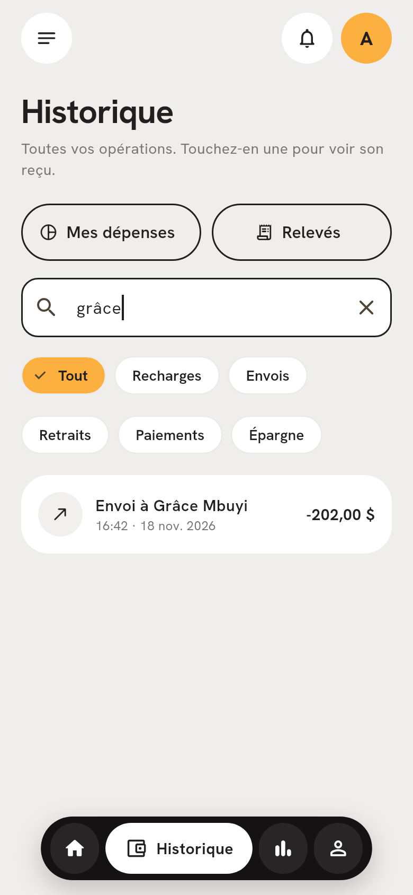

- API : `GET /v1/me/history?q=…`, avec les autres paramètres habituels. 60 caractères au plus (`INVALID_SEARCH`). Un numéro est comparé sur ses 9 derniers chiffres, quelle que soit la façon de l'écrire (« 0970 004 102 », « +243… »). Les `%` et `_` tapés sont cherchés tels quels.
- L'app attend que le client ait fini de taper (400 ms) avant d'interroger le serveur, puis ignore les réponses arrivées trop tard.

## Mes dépenses

Dans l'app, Historique, puis **Mes dépenses** : où part l'argent du mois, par catégorie, comparé au mois d'avant.

- Catégories :
  - envois ;
  - paiements chez un marchand ;
  - factures ;
  - crédit téléphone ;
  - retraits ;
  - frais, à part pour qu'ils se voient.
- Un remboursement (crédit refusé, facture ou retrait rendu) vient en déduction. Une opération échouée ne compte pas.
- L'épargne n'est pas une dépense : « Mis de côté » est affiché à part, comme « Reçu » (recharges et envois reçus).
- Le mois en cours se compare au mois d'avant **arrêté au même jour** : le 19 novembre se compare au 1er–19 octobre, pas à tout octobre.
- « À qui vous envoyez le plus » : les 3 personnes qui ont reçu le plus, numéro masqué.
- Le client choisit parmi les 6 derniers mois. Les montants viennent du même calcul que le relevé.
- API : `GET /v1/me/spending?month=2026-11`, le mois en cours si `month` est absent.

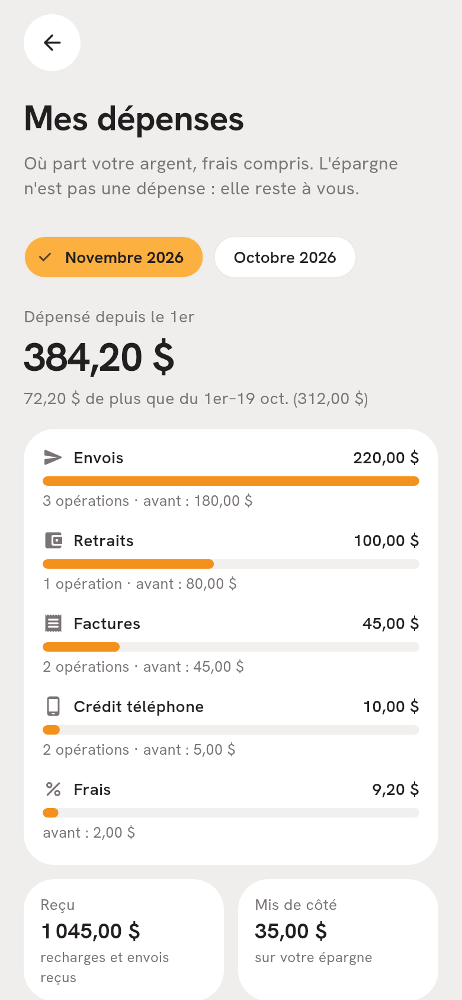

## Relevés de compte

Dans l'app, Historique → **Relevés de compte** : un relevé par mois depuis l'ouverture du compte (24 au plus), le mois en cours arrêté à aujourd'hui. Le relevé donne le solde au 1er du mois, les entrées, les sorties (dont les frais), le solde de fin et chaque opération avec son n° de reçu. Le client le télécharge en PDF A4 et le partage (WhatsApp, e-mail, Fichiers) : utile pour tenir ses comptes ou prouver ses revenus à un bailleur ou une banque.

- Les montants viennent du grand livre, comme l'historique : le solde de fin d'un mois est le solde d'ouverture du suivant. Les numéros des autres clients restent masqués.
- API : `GET /v1/me/statements` (mois disponibles), `GET /v1/me/statements/{AAAA-MM}`, `GET /v1/me/statements/{AAAA-MM}/pdf`.
- PDF produit par OpenPDF (LGPL/MPL). Exemple : `docs/captures-app/9b-releve-octobre.pdf`.

## Paiement de factures

Menu **Plus** → **Payer une facture** : électricité (SNEL, compteurs prépayés), eau (REGIDESO), télévision (Canal+, DStv). Le client tape son numéro de compteur ou d'abonné, l'app affiche le **nom du titulaire** chez le facturier (et le montant dû pour une facture) avant tout paiement, puis il paie avec son PIN. Pour un compteur prépayé, il reçoit le **code à taper sur le compteur** à l'écran et par SMS. Les comptes déjà payés sont proposés en un geste.

| Facturiers | Compteur vérifié | Code du compteur |
|---|---|---|
| 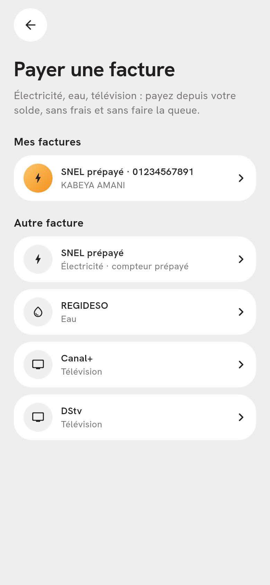 | 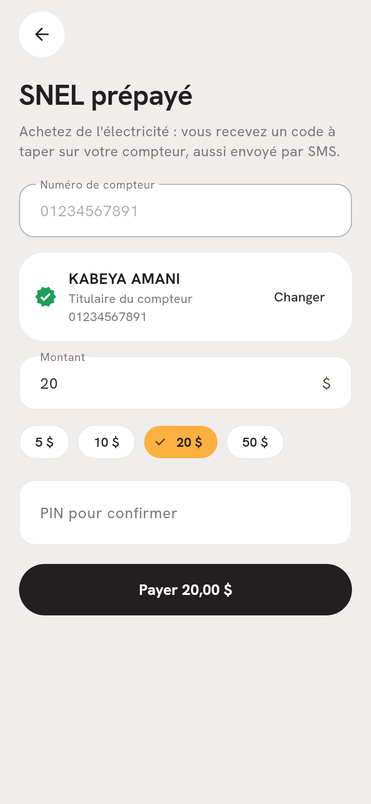 | 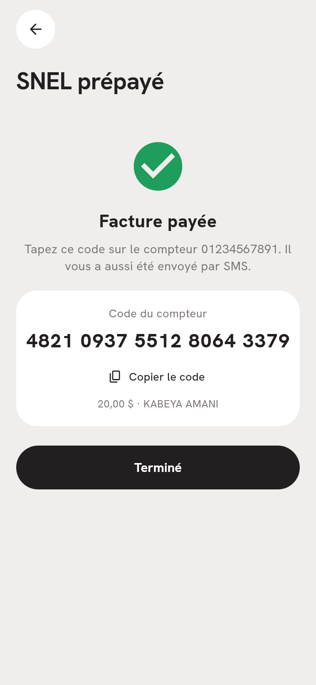 |

- Sans frais pour le client, de 1 $ à 500 $ par paiement (`capital-invest.bills`), dans le plafond par opération et le plafond journalier d'envoi.
- Même schéma que le crédit téléphone : le montant passe du portefeuille au compte `BILLERS_USD` sous verrou, le facturier est payé hors transaction, un refus rembourse aussitôt le client (avec notification), un doute laisse le paiement « en cours » sans remboursement.
- Le code du compteur part aussi par SMS : le client l'a même si l'app se ferme ou si le téléphone s'éteint. Il reste dans le reçu.
- API : `GET /v1/bills/billers`, `POST /v1/bills/lookup` (`{"biller", "reference"}`), `POST /v1/bills` (`{"biller", "reference", "amountMinor", "pin"}`, en-tête `Idempotency-Key`), `GET /v1/bills/recent`, `GET /v1/bills/{id}`.
- **Pas encore branché** : l'agrégateur de factures réel (interface `BillConnector`). Le simulateur ne connaît pas les références qui finissent par 0000 et refuse le paiement de celles qui finissent par 9999. Les facturiers proposés et les formats de référence sont à confirmer avec l'agrégateur retenu.

## Crédit téléphone (unités)

Menu **Plus** → **Acheter du crédit téléphone** : des unités pour son numéro ou celui d'un proche, sur Vodacom, Airtel, Orange et Africell. Le réseau est deviné d'après le préfixe (le client peut le changer pour un numéro porté), les derniers numéros rechargés sont proposés en un geste, et l'achat se confirme par le PIN.

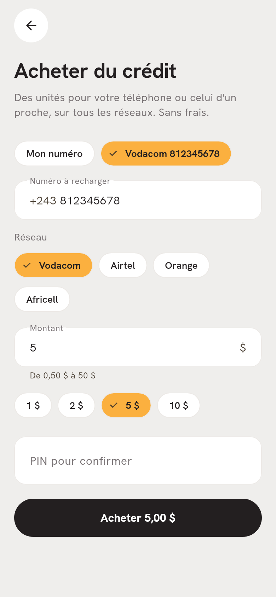

- Sans frais pour le client, de 0,50 $ à 50 $ par achat (`capital-invest.airtime`). L'achat compte dans le plafond journalier d'envoi.
- Dans le grand livre : le montant passe du portefeuille au compte `AIRTIME_PROVIDER_USD` (crédit prépayé chez le prestataire). Si le prestataire refuse (numéro inactif…), le montant revient aussitôt au client, qui est prévenu. Sans réponse sûre, l'achat reste « en cours » et n'est pas remboursé : les unités sont peut-être parties.
- Historique, reçu et relevé : « Crédit Vodacom » avec le numéro rechargé ; « Crédit non envoyé, remboursé » pour un refus.
- API : `POST /v1/airtime` (`{"phone", "network"?, "amountMinor", "pin"}`, en-tête `Idempotency-Key`), `GET /v1/airtime/recent`, `GET /v1/airtime/{id}`.
- **Pas encore branché** : le prestataire réel. Le simulateur envoie toujours les unités, sauf vers un numéro qui finit par 0000. Il faudra choisir un agrégateur d'unités (contrat, commission reçue sur chaque achat), écrire son connecteur (interface `AirtimeConnector`) avant la mise en service.

### Achats restés « en cours »

Quand le prestataire d'unités ou l'agrégateur de factures ne répond pas clairement, l'achat n'est ni perdu ni remboursé à l'aveugle :

- **Relance automatique** (`PurchaseJobs`, chaque minute) : le statut est redemandé au prestataire après 1 min, puis 2, 4, 8… jusqu'à une relance par heure. Une réponse « envoyé » ou « payé » termine l'achat (le code du compteur part par SMS), un refus rembourse le client.
- **Après 24 h sans réponse**, l'achat passe « en vérification » : le client le voit ainsi dans son historique, et il apparaît dans le back-office (**Rapprochement** → « Crédit téléphone et factures sans réponse »), avec ceux qui attendent depuis plus de 10 minutes.
- **Décision d'un agent** (conformité ou administrateur), toujours motivée et inscrite au journal d'audit : « Noter envoyé / payé » (pour un compteur prépayé, le code de 20 chiffres donné par l'agrégateur est obligatoire et envoyé au client), ou « Rembourser » quand le prestataire confirme l'échec.
- Réglages : `capital-invest.airtime.first-check-after`, `review-after` (idem sous `bills`), `capital-invest.purchases.poll-delay-ms`. API : `GET /v1/backoffice/purchases/review`, `POST /v1/backoffice/airtime/{id}/resolve` et `/bills/{id}/resolve` (`{"action": "DONE" | "REFUND", "note", "token"?}`).
- Simulateur : un numéro qui finit par 5555 (ou une référence en 5555) ne répond pas tout de suite mais aboutit à la relance ; 6666 ne répond jamais et finit en vérification.

## Épargne

Le client met de l'argent de côté depuis l'accueil (carte **Épargne**) ou le menu : **Mettre de côté** fait passer l'argent du solde à l'épargne, **Reprendre** le ramène sur le solde, à tout moment. Il peut fixer un objectif (un nom comme « Rentrée scolaire » et un montant) et voit où il en est.

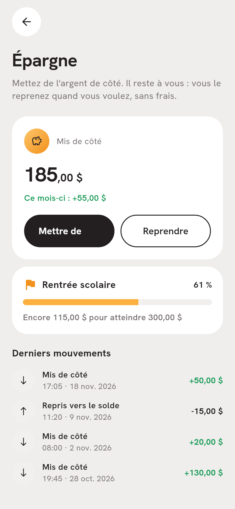

- Dans le grand livre, l'épargne est un second compte du client (`CUSTOMER_SAVINGS`), ouvert au premier dépôt. L'argent ne quitte pas Capital Invest : pas de frais, pas de PIN (l'argent ne peut aller que sur le solde du même client), pas de plafond d'envoi, pas de notification.
- Le **solde maximal** du niveau KYC compte le solde et l'épargne ensemble : mettre de côté ne permet pas de recevoir plus.
- Les mouvements apparaissent dans l'historique et le relevé (« Mis de côté », « Repris de l'épargne »), avec un filtre Épargne. Le back-office montre l'épargne du client à côté de son solde.
- Pas d'intérêts pour l'instant : en verser demande l'avis de la BCC et un placement de l'argent correspondant.
- API : `GET /v1/me/savings`, `POST /v1/me/savings/deposits` et `/withdrawals` (`{"amountMinor"}`, en-tête `Idempotency-Key`), `PUT` et `DELETE /v1/me/savings/goal`.

## Notifications au client

Tout ce qui touche l'argent ou le compte du client est notifié : recharge reçue, argent reçu, envoi effectué, retrait versé, retrait remboursé, correction de solde, décision sur le niveau 2, PIN changé. Un envoi que le client n'a pas fait est souvent le premier signe d'un vol de compte : chaque sortie d'argent est donc notifiée.

- **Rien ne se perd** : la notification est écrite dans la même transaction que le mouvement d'argent (table `notification`), puis le SMS part juste après. Une passerelle indisponible est relancée après 1, 2, 4 et 8 minutes ; après 5 essais le SMS est abandonné, la notification reste dans l'app. Un rejeu d'opération ne renvoie jamais de second SMS.
- **SMS** : 160 caractères au plus, sans accents (un SMS accentué compte double), avec le nouveau solde et le numéro de reçu. Les codes de connexion ne passent pas par là.
- **App** : la cloche de l'accueil porte une pastille tant qu'il reste des notifications non lues. `GET /v1/me/notifications` (avec `unread`) et `POST /v1/me/notifications/read` (toutes, ou `{"ids": [...]}`). Une notification liée à une opération ouvre son reçu.
- La passerelle SMS est encore le simulateur : il faudra brancher un fournisseur (agrégateur SMS ou opérateur) avant la mise en service. Les notifications push viendront plus tard.

## Alerte de solde bas

Dans l'app, sous Notifications, puis **Alerte de solde bas** : le client choisit un seuil (5, 10, 20 ou 50 $, ou un autre montant entre 1 $ et 1 000 $). Il reçoit un SMS et une notification quand son solde passe dessous, par exemple : « votre solde est de 19,20 $, sous votre seuil de 20,00 $ ».

- Le client n'est prévenu **qu'une fois** par passage sous le seuil, pas à chaque achat. L'alerte se réarme quand le solde repasse au-dessus, après une recharge ou un envoi reçu.
- Pas d'alerte au moment où le client choisit le seuil, même si son solde est déjà dessous : il le voit à l'écran.
- Le contrôle se fait dans la même transaction que le mouvement d'argent, en une seule requête qui ne modifie la ligne du client que si l'état change.
- Toucher la notification « Solde bas » ouvre ce réglage.
- API : `GET` et `PUT /v1/me/notifications/low-balance` (`thresholdMinor`, ou `null` pour ne plus être prévenu).

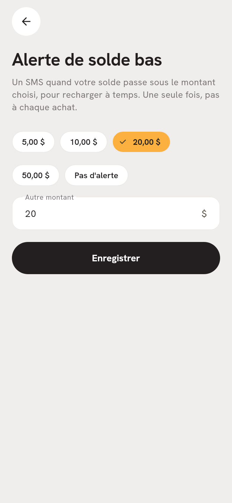

## Paiement chez un marchand (QR)

Le client paie en caisse depuis son solde : il touche **Payer**, scanne le QR affiché par le commerce (ou tape le code de 6 caractères écrit dessous), vérifie le nom du commerce, tape le montant et confirme par son PIN. L'app affiche alors une preuve à montrer au caissier (montant, commerce, heure, numéro de reçu).

- **Pas de frais pour le client.** Le marchand reçoit le montant moins sa commission (1 % par défaut, `capital-invest.merchants.default-commission-bps`, **provisoire**, réglable par marchand de 0 à 10 %). La commission va au compte de revenus, comme les frais d'envoi.
- **Le caissier reçoit un SMS** à chaque paiement, sur le numéro du marchand : montant, client (numéro masqué), net après commission, numéro de reçu.
- Le paiement compte dans le plafond journalier de sortie du client, avec les envois et les retraits. Rejouer la demande (même `Idempotency-Key`) ne débite jamais deux fois.
- L'argent reçu reste sur le compte du marchand chez Capital Invest (`MERCHANT_WALLET`, une dette envers lui) jusqu'au reversement, ci-dessous.
- Le QR contient `capitalinvest://pay?m=CODE`. Le code n'a ni `0`/`O` ni `1`/`I`, pour être lu et tapé sans erreur.

API client : `GET /v1/merchants/{code}` (le commerce avant de payer ; un marchand suspendu répond `MERCHANT_NOT_ACTIVE`) et `POST /v1/merchant-payments` (`merchantCode`, `amountMinor`, `pin`, `note` facultative, en-tête `Idempotency-Key`). Dans l'historique, le paiement apparaît en `MERCHANT_PAYMENT` (filtre `category=PAYMENT`).

Back-office, écran « Marchands » : l'administrateur crée le marchand, imprime son affiche QR et peut le suspendre avec un motif (`POST /v1/backoffice/merchants`, `POST /v1/backoffice/merchants/{id}/status`) ; la conformité consulte la liste, le dû à chaque marchand et ses derniers paiements. Création et suspension sont inscrites au journal d'audit.

### Reversement aux marchands

Ce que Capital Invest doit au marchand part vers son **compte mobile money de reversement** (M-Pesa, Airtel Money ou Orange Money), sur demande d'un administrateur depuis l'écran « Marchands » (bouton « Reverser »). Pas de frais : la commission prélevée sur les paiements les couvre.

- C'est un retrait comme celui d'un client, depuis le compte du marchand, avec les **mêmes garanties** : l'argent est bloqué avant l'appel à l'opérateur ; il ne revient au marchand que sur un échec certain ; un doute passe en vérification ; le rapprochement de nuit couvre aussi les reversements. Le même identifiant de demande rejoué ne reverse jamais deux fois.
- Le marchand reçoit un SMS quand le reversement est versé, ou refusé (l'argent reste alors sur son compte).
- **Compte de reversement protégé** : c'est ce qu'un fraudeur chercherait à changer. Le premier compte est utilisable tout de suite ; un changement prévient le marchand par SMS sur son numéro habituel et **bloque les reversements 24 h** (`capital-invest.merchants.payout-account-cooldown-hours`). Chaque changement et chaque reversement est au journal d'audit.
- Reversement minimum : 1,00 $ (`min-payout-minor`).
- API : `POST /v1/backoffice/merchants/{id}/payout-account` (`operator`, `phone`) et `POST /v1/backoffice/merchants/{id}/payouts` (`requestId`, `amountMinor` facultatif : tout ce qui est dû), réservés aux administrateurs. La fiche marchand liste les derniers reversements et leur état.
- **Reversement automatique chaque nuit** : vers 1 h 30 (heure de Lubumbashi, avant le rapprochement de 2 h), tout ce qui est dû à chaque marchand actif part vers son compte de reversement, s'il atteint 10,00 $ (`auto-payout-min-minor`). Un marchand dont le compte vient de changer, ou qui a déjà un reversement en cours ou à vérifier, attend la nuit suivante. La même nuit ne reverse jamais deux fois (identifiant `auto:<date>`), même si la tâche repasse. Le journal d'audit les note comme actions du système, et la fiche marchand les marque « automatique ».
- Activé par défaut pour chaque nouveau marchand ; un administrateur le coupe ou le remet depuis la fiche (`POST /v1/backoffice/merchants/{id}/auto-payout`, `enabled`). Toute la tâche se coupe avec `capital-invest.merchants.auto-payout-enabled: false`, l'heure se règle avec `auto-payout-cron`.
- Pas encore fait : reversement vers un compte bancaire.

## Mon QR pour recevoir

Dans le menu, « Mon QR pour recevoir » affiche un QR avec le nom et le numéro du client. Un proche le scanne avec **Payer**, comme un QR marchand : l'app reconnaît un QR de client et ouvre **l'envoi avec le numéro déjà rempli**. Le client peut aussi y mettre un montant : celui qui scanne n'a plus qu'à vérifier le nom et confirmer avec son PIN. « Partager mon numéro » envoie le numéro par WhatsApp ou SMS.

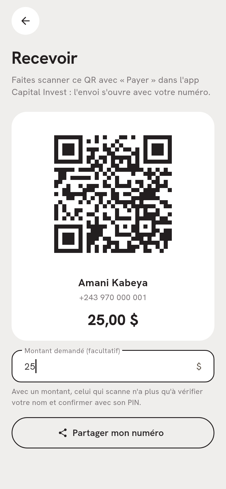

- Contenu du QR : `capitalinvest://send?p=243970000001&a=2500` (le montant `a`, en centimes, est facultatif). Il n'y a rien de secret dedans : seulement le numéro et le montant.
- Même vérification qu'un envoi tapé à la main : le nom du destinataire s'affiche avant le PIN. Le QR est dessiné en noir sur blanc même en mode sombre, ce qui le rend plus facile à lire.
- Tout se passe dans l'app : le serveur ne change pas.

## Demander de l'argent

Un client demande un montant à un autre client (menu « Demander de l'argent » de l'app). Le client sollicité reçoit un SMS et une notification, voit la demande en haut de son accueil, puis **paie avec son PIN** ou **refuse**.

- Payer, c'est faire un envoi ordinaire au demandeur : mêmes frais (payés par celui qui paie), mêmes plafonds, même reçu. Rejouer le paiement ne paie jamais deux fois.
- L'écran de paiement rappelle de ne payer que quelqu'un qu'on connaît : ces demandes sont un terrain d'arnaque connu. Le SMS ne contient aucun lien.
- Le refus prévient le demandeur dans l'app (sans SMS). Le demandeur peut annuler une demande en attente. Sans réponse, une demande expire au bout de 7 jours.
- Contre le harcèlement : 10 demandes par client en 24 h, et 3 demandes en attente au plus vers un même client (`capital-invest.money-requests`).
- API : `POST /v1/money-requests` (`payerPhone`, `amountMinor`, `note`, en-tête `Idempotency-Key`), `GET /v1/money-requests` (`toPay`, `recent`), `POST /v1/money-requests/{id}/pay` (`pin`), `/decline`, `/cancel`.

## Vérifier le destinataire avant d'envoyer

Un envoi au mauvais numéro ne se rattrape pas. Avant la confirmation par PIN, l'app affiche donc le **prénom et l'initiale** du destinataire (« Josué K. »), assez pour reconnaître un proche sans exposer le nom complet d'un inconnu. Un numéro sans compte est arrêté avant même le calcul des frais. Les derniers destinataires sont proposés en un geste.

| Destinataires récents | Nom vérifié avant le PIN |
|---|---|
| 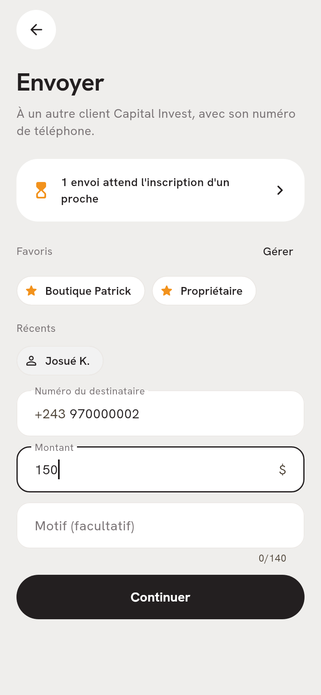 | 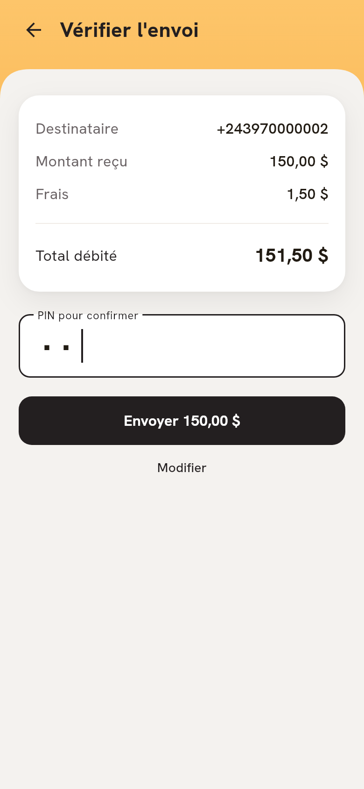 |

- Contre la collecte des noms : 30 numéros vérifiés par heure et par client (`capital-invest.recipients.max-lookups-per-hour`). Les numéros inconnus comptent aussi.
- Même vérification pour un envoi programmé. Un compte suspendu ou fermé est signalé (« ne peut pas recevoir d'argent pour le moment »).
- API : `GET /v1/transfers/recipient?phone=…` (`{"phone", "displayName"}`), `GET /v1/transfers/recent` (5 derniers destinataires).

## Contacts favoris

Après un envoi, le client peut enregistrer le destinataire sous un **surnom** (« Maman », « Boutique Patrick »). Les favoris apparaissent en tête de l'écran d'envoi, avant les récents, et un favori ne se répète pas dans les récents. « Gérer » permet d'en retirer.

| Ajouter après un envoi | Favoris en tête de l'écran d'envoi |
|---|---|
| 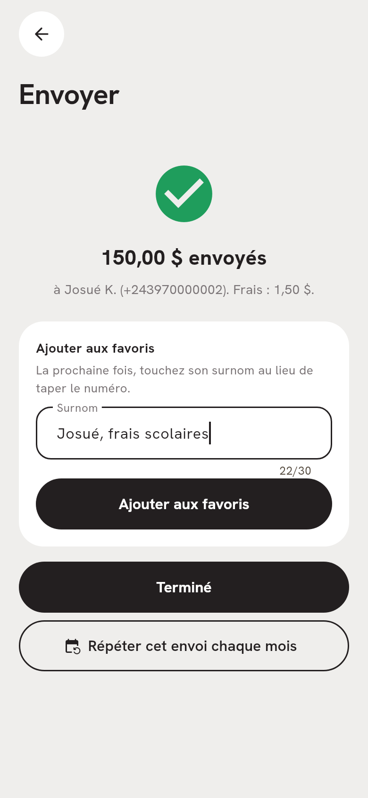 |  |

- 20 favoris au plus, surnom de 1 à 30 caractères. Enregistrer à nouveau le même numéro change seulement le surnom.
- L'ajout passe par la vérification du destinataire : il compte dans les 30 numéros vérifiés par heure, donc les favoris ne contournent pas la protection contre la collecte des noms. On ne peut pas se mettre soi-même en favori.
- Un favori dont le compte est suspendu ou fermé n'est plus proposé.
- API : `GET /v1/me/favorites`, `POST /v1/me/favorites` (`{"phone", "nickname"}`), `DELETE /v1/me/favorites/{id}`.

## Envoyer à un proche sans compte

Beaucoup de proches n'ont pas encore Capital Invest. Quand le numéro tapé n'a pas de compte, l'app ne s'arrête plus sur une erreur : elle propose d'**envoyer quand même**. Le client donne le nom de son proche et confirme avec son PIN. Le proche reçoit un SMS, et l'argent lui est **versé dès qu'il ouvre son compte avec ce numéro**. Sans compte au bout de 7 jours, l'argent revient à l'expéditeur, **frais compris**. L'expéditeur peut aussi annuler avant.

| Numéro sans compte | Nom du proche et PIN | Suivi des envois |
|---|---|---|
| 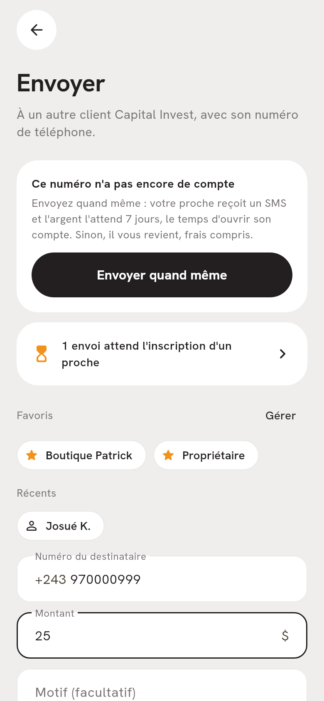 | 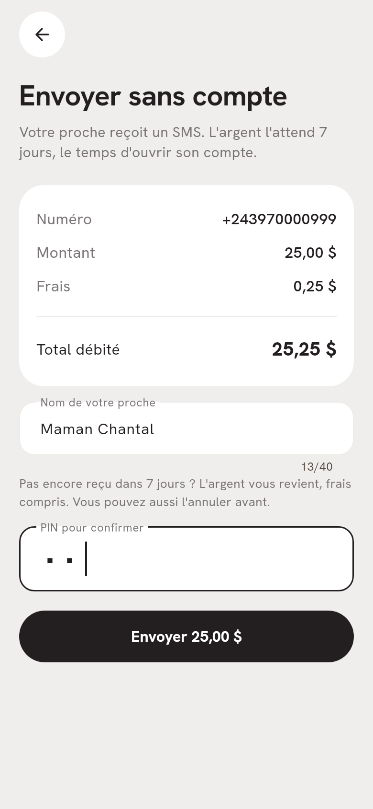 | 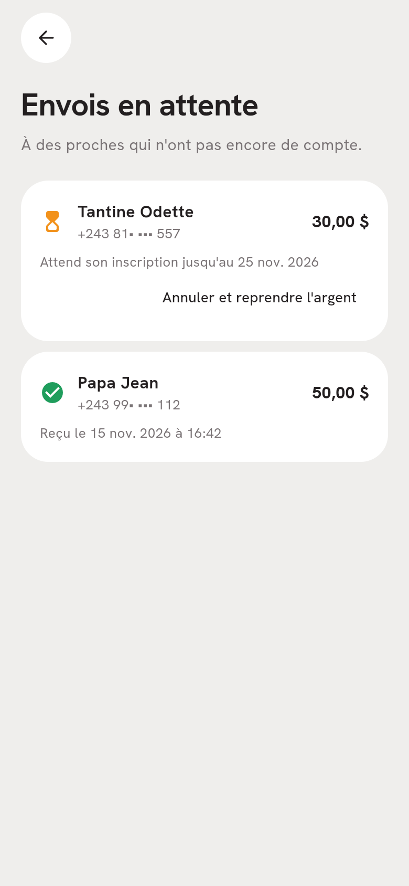 |

- Grand livre : l'argent passe du portefeuille au compte d'attente `PENDING_TRANSFERS_USD`, puis au portefeuille du proche (`TRANSFER_INVITE_CLAIM`) ou retour à l'expéditeur avec les frais (`TRANSFER_INVITE_REFUND`). Rien n'est perdu entre les deux.
- Plafonds de l'expéditeur comme pour un envoi. Au plus 100 $ par envoi, 3 envois en attente par expéditeur et 500 $ en attente pour un même numéro (`capital-invest.pending-transfers.*`). Un envoi qui dépasserait le solde maximal du nouveau compte (KYC 1) revient à l'expéditeur.
- Le versement se fait dans la transaction de l'inscription. Le SMS au proche passe par la file des notifications, avec ses relances. L'expéditeur est prévenu quand son proche a reçu l'argent ou quand l'argent lui revient.
- Historique : « Envoi à Maman Chantal », état « En attente de son inscription », puis terminé ou « Envoi remboursé ». Un compte avec un envoi en attente ne peut pas être fermé.
- API : `POST /v1/transfers/pending` (`{"toPhone", "recipientName", "amountMinor", "pin", "note"}`, en-tête `Idempotency-Key`), `GET /v1/transfers/pending`, `DELETE /v1/transfers/pending/{id}` (annuler).

## Envois programmés

Menu **Plus** → **Envois programmés** : le loyer chaque mois, l'argent pour la famille chaque semaine. Le client choisit le destinataire, le montant, le rythme et le jour, voit les frais de chaque envoi, puis confirme **une fois** par son PIN. Après un envoi ordinaire, « Répéter cet envoi chaque mois » préremplit le formulaire.

| Envois programmés | Vérifier et confirmer |
|---|---|
| 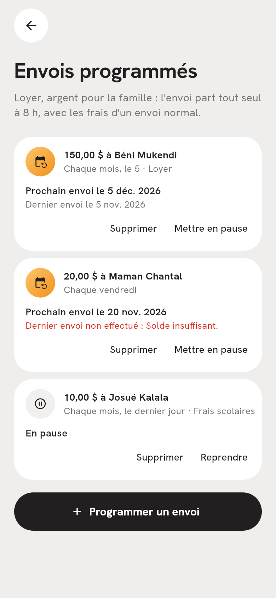 | 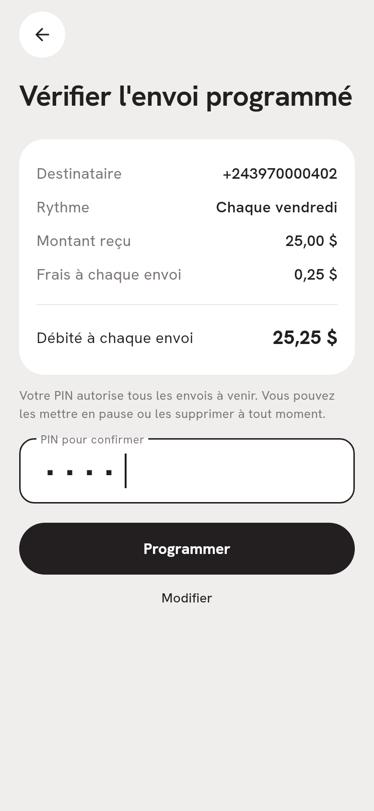 |

- L'envoi part à 8 h, heure de Lubumbashi (`capital-invest.scheduled-transfers.run-at`). Le 31 devient le dernier jour d'un mois plus court.
- Chaque échéance est un envoi ordinaire : frais, plafond par opération, plafond journalier, et pause de 24 h après un changement de PIN. Sa clé d'idempotence (`scheduled:<id>:<date>`) garantit qu'une même échéance ne part jamais deux fois, même traitée par deux serveurs.
- Si l'envoi ne peut pas partir (solde insuffisant, plafond…), le client est prévenu par SMS et dans l'app avec la raison, et l'échéance suivante reste prévue. Après 3 échecs d'affilée, l'envoi se met en pause (`pause-after-failures`). Une reprise ne rattrape pas les échéances manquées.
- Le client peut mettre en pause, reprendre ou supprimer à tout moment ; au plus 10 envois programmés. La fiche client du back-office montre ses envois programmés et ses réclamations, pour répondre à « de l'argent part tout seul de mon compte ».
- API : `POST /v1/me/scheduled-transfers` (`{"toPhone", "amountMinor", "frequency": "WEEKLY" | "MONTHLY", "day", "note"?, "pin"}`), `GET /v1/me/scheduled-transfers`, `POST /v1/me/scheduled-transfers/{id}/pause` et `/resume`, `DELETE /v1/me/scheduled-transfers/{id}`. Back-office : `GET /v1/backoffice/customers/{id}/scheduled-transfers`.

## Réclamations

Depuis le reçu d'une opération, le client touche **Signaler un problème**, choisit ce qui ne va pas (argent non arrivé, mauvais montant ou frais, opération qu'il n'a pas faite, autre) et explique en quelques mots. Il reçoit aussitôt un numéro (REC-AAAAMMJJ-XXXXXX) et la date de réponse promise, dans l'app et par SMS. **Plus** → **Mes réclamations** montre celles en attente et les réponses.

| Signaler depuis le reçu | Réclamation enregistrée |
|---|---|
| 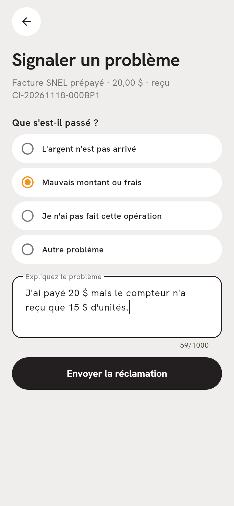 |  |

Dans le back-office, **Réclamations** (conformité et administrateurs) liste les réclamations à traiter avec l'opération telle que le reçu la montre, numéros en clair. Les « opération que je n'ai pas faite » passent en tête (vol de compte possible : l'app propose aussi au client de changer son PIN), puis les plus proches de l'échéance ; celles en retard sont signalées.

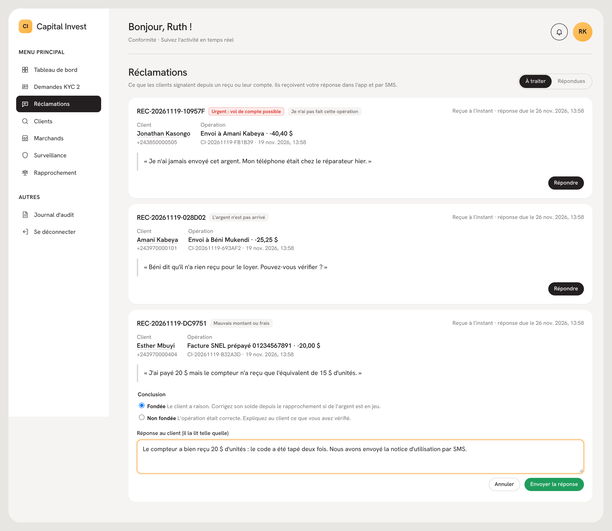

- L'agent conclut **fondée** ou **non fondée** et écrit la réponse que le client lira telle quelle. Elle part par SMS et dans l'app ; la décision entre au journal d'audit. Une correction d'argent se fait ensuite par les outils existants (rapprochement).
- Une seule réclamation ouverte par client et par opération, et au plus 5 ouvertes en même temps (`capital-invest.complaints.max-open-per-customer`). Une opération qui ne touche pas le portefeuille du client n'existe pas pour lui.
- Délai de réponse : 7 jours par défaut (`capital-invest.complaints.response-time`). **À confirmer avec la conformité** selon l'exigence de la BCC sur le traitement des réclamations.
- API client : `POST /v1/me/complaints` (`{"transactionId"?, "category", "message"}`), `GET /v1/me/complaints`, `GET /v1/me/complaints/{id}`. Back-office : `GET /v1/backoffice/complaints?status=OPEN|ANSWERED`, `GET /v1/backoffice/customers/{id}/complaints`, `POST /v1/backoffice/complaints/{id}/answer` (`{"outcome", "answer"}`).

## Surveillance des opérations (anti-blanchiment)

Après chaque mouvement d'argent, le serveur regarde le comportement récent des clients concernés. Une règle franchie ouvre une alerte pour la conformité, dans le menu **Surveillance** du back-office. Rien n'est bloqué automatiquement, et le client n'est jamais prévenu : il ne doit pas savoir qu'il est surveillé.

| Règle | Se déclenche quand… (seuils par défaut) |
| --- | --- |
| Rafale d'opérations | 10 sorties d'argent (envois, paiements, retraits) en une heure |
| Montants juste sous le plafond | 3 opérations en 24 h à 90 % ou plus du plafond par opération du client |
| Argent reçu de nombreux clients | 5 expéditeurs différents en 24 h (compte collecteur) |
| Retrait aussitôt l'argent reçu | 80 % ou plus de ce qui est entré en 24 h retiré, à partir de 500,00 $ entrés |

- Une seule alerte ouverte par client et par règle : la suivante attend que la première soit traitée.
- La conformité (ou un administrateur) ouvre les opérations du client, puis **classe sans suite** ou **suspend le compte**, toujours avec une note. Un compte suspendu perd ses sessions, ne peut plus se connecter ni faire bouger son argent ; il se réactive depuis la fiche client, avec une note aussi. Tout passe au journal d'audit.
- Le contrôle tourne après la fin de l'opération, dans sa propre transaction : une erreur de surveillance ne bloque jamais l'argent.
- Seuils PROVISOIRES dans `capital-invest.monitoring` (`application.yml`) : à valider par la conformité, puis à ajuster avec les premiers mois d'activité réelle.
- API : `GET /v1/backoffice/monitoring/alerts` (`status` : `OPEN`, `CLOSED` ou `ALL` ; `customerId` facultatif), `POST /v1/backoffice/monitoring/alerts/{id}/resolve` (`action` : `DISMISS` ou `SUSPEND`, `note`), `POST /v1/backoffice/customers/{id}/status` (`status` : `ACTIVE` ou `SUSPENDED`, `reason`).

Les marchands sont surveillés aussi, à chaque paiement reçu. Un faux commerce peut servir à blanchir : l'argent entre par de faux achats et ressort par le reversement.

| Règle (marchand) | Se déclenche quand… (seuils par défaut) |
| --- | --- |
| Le marchand se paie lui-même | Un paiement vient du numéro de téléphone du marchand |
| Un client paie le marchand encore et encore | Le même client paie le même marchand 5 fois en 24 h |
| Encaissements anormalement élevés | 1 000,00 $ ou plus encaissés en 24 h, et au moins 3 fois la moyenne quotidienne des 30 jours d'avant |

- Une alerte sur un marchand mène à sa fiche. **Suspendre** suspend le marchand (plus de paiement, plus de reversement automatique), pas les clients qui l'ont payé. Pas de déclaration de soupçon depuis une alerte marchand : la déclaration porte sur une personne, ouverte depuis l'alerte ou la fiche du client concerné.
- La fiche du marchand montre ses alertes, traitées ou non. API : `GET /v1/backoffice/monitoring/alerts?merchantId=…`.

### Déclarations de soupçon (CENAREF)

Quand une alerte ne s'explique pas, la conformité clique **Déclarer** (sur une alerte à traiter, ou sur un compte déjà suspendu). Le back-office ouvre un dossier prérempli :

- l'identité de la personne déclarée (nom, téléphone, pièce d'identité vérifiée au KYC 2, date de naissance, solde, ancienneté) ;
- les faits, préremplis avec les alertes du client, à compléter ;
- l'analyse : pourquoi c'est suspect, à rédiger ;
- les alertes et toutes les opérations de la période (par défaut les 30 jours avant l'alerte), avec le total des entrées et des sorties. Au-delà de 500 opérations, seules les plus récentes figurent : joindre l'extrait complet.

Capital Invest ne transmet rien elle-même : la conformité **imprime** le dossier, l'envoie par le canal officiel de la CENAREF, puis note la date d'envoi et la référence reçue. Le dossier est alors figé : plus aucune modification n'est possible. Chaque ouverture, rédaction et transmission passe au journal d'audit. Comme pour les alertes, le client n'est jamais prévenu.

- Réservé à la conformité et aux administrateurs. Menu **Surveillance**, onglet **Déclarations**.
- API : `GET /v1/backoffice/suspicion-reports`, `POST /v1/backoffice/suspicion-reports` (`customerId`, `alertId` facultatif), `GET` et `PUT /v1/backoffice/suspicion-reports/{id}` (`periodFrom`, `periodTo`, `facts`, `analysis`), `POST /v1/backoffice/suspicion-reports/{id}/submit` (`submittedOn`, `cenarefReference`).
- À valider avec la conformité : le contenu exact attendu par la CENAREF et le délai de transmission. Le dossier suit les rubriques habituelles d'une déclaration (identité, faits, analyse, opérations), pas encore un formulaire officiel.

## Activité de la plateforme (back-office)

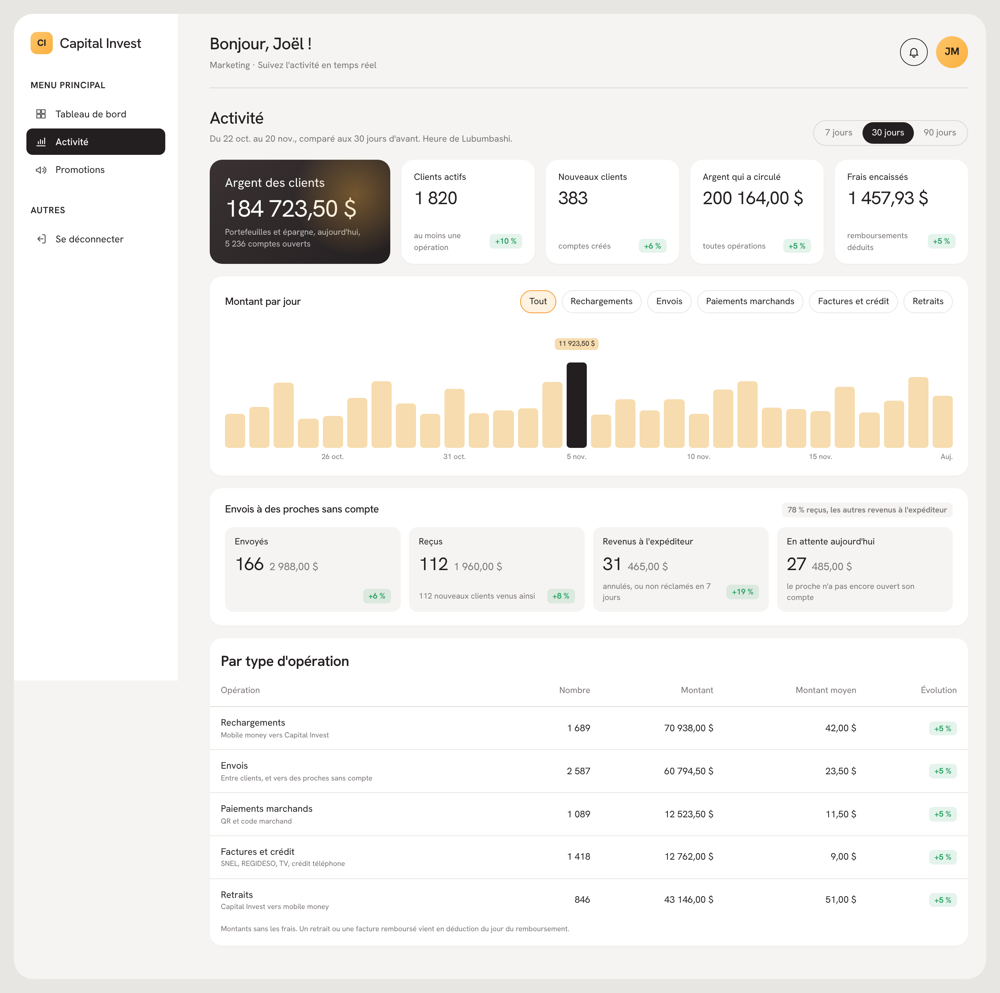

L'écran « Activité » donne à la direction, à la conformité et au marketing les chiffres de la plateforme sur 7, 30 ou 90 jours, comparés à la période précédente de même durée :

- l'argent que les clients ont chez Capital Invest aujourd'hui (portefeuilles et épargne), le nombre de clients actifs et de nouveaux comptes ;
- par type d'opération (rechargements, envois, paiements marchands, factures et crédit, retraits) : nombre, montant, montant moyen et évolution. Les envois comptent ceux entre clients et ceux vers un proche sans compte, remboursements déduits ;
- les envois à des proches sans compte : envoyés, reçus (chacun est un nouveau client venu par un client), revenus à l'expéditeur (annulés ou non réclamés en 7 jours), et ce qui attend aujourd'hui, avec la part des envois reçus ;
- les frais encaissés, remboursements de frais déduits ;
- un graphique du montant par jour, pour toutes les opérations ou une seule famille.

Tout est recalculé à partir du grand livre, par jour à l'heure de Lubumbashi, sans table de statistiques à tenir à jour. Les montants sont hors frais ; un retrait, une facture ou un crédit téléphone remboursé vient en déduction du jour du remboursement. L'écran ne montre aucune donnée personnelle, seulement des totaux ; les agents KYC n'y ont pas accès.

- API : `GET /v1/backoffice/activity?days=30` (de 1 à 90 jours, sinon `INVALID_PERIOD`), rôles `COMPLIANCE`, `ADMIN` et `MARKETING`.
- Captures : [sombre](docs/captures-backoffice/15-activite-sombre.png), [téléphone](docs/captures-backoffice/15b-activite-mobile.png).

## Règles du grand livre

- Tout mouvement d'argent passe par `LedgerService.post` : au moins deux lignes, débits = crédits.
- Le solde n'est jamais stocké : il est calculé à partir des écritures.
- Les écritures sont en ajout seul (un déclencheur PostgreSQL interdit modification et suppression).
- Chaque opération porte une clé d'idempotence : la rejouer ne débite jamais deux fois.
- Un portefeuille client ne passe jamais sous zéro ; la vérification se fait sous verrou.
- Montants en unités mineures (`Long`, centimes) : jamais de `Double` pour de l'argent.

## Documentation

- Dossier d'analyse : https://claude.ai/artifact/GEDWpquzQD3h9fo3LrpHTt
- Analyse UML : https://claude.ai/artifact/KBMn7NR9qxV5wrgXxSNkjj
